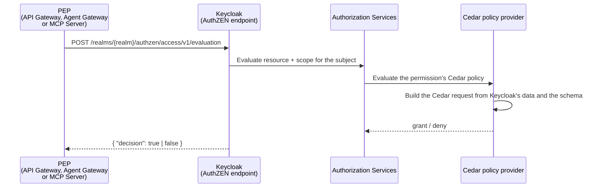

# Keycloak Cedar Authorization

A [Keycloak](https://www.keycloak.org/) extension that integrates [Cedar](https://www.cedarpolicy.com/) as a policy type in Keycloak Authorization Services, enabling Keycloak's [AuthZEN](https://openid.net/specs/authorization-api-1_0.html) endpoint to evaluate authorization requests for users and AI agents using Cedar policies.

For the background and design, see [Keycloak Cedar Policy Engine](https://twogenidentity.com/research/keycloak-cedar-policy-engine/), a research article by TwoGenIdentity.

## Overview

Keycloak exposes an AuthZEN endpoint: a PEP, such as an API gateway or an MCP server, asks "may this subject
do this action on this resource?" and Keycloak answers with a decision. Keycloak takes that decision with
the policies of its Authorization Services: role, group, user, time or JavaScript policies, combined in
permissions.

These policies work well for simple rules, but fine grained rules (on resource attributes, on how the user
logged in, on which agent is calling) end up in JavaScript policies that are hard to review and test.

This extension adds **Cedar**, a policy language designed for authorization, as a new policy type. Keycloak
Authorization Services then acts as a **Policy Decision Point (PDP) compatible with AuthZEN, powered by
Cedar**. Cedar runs inside Keycloak through [cedar-java](https://github.com/cedar-policy/cedar-java); no
external PDP is required.

### Features

- **Cedar policy type**: a Cedar policy is used by Keycloak permissions like any other policy.
- **Your own model**: each resource server describes its resource types, actions and context in a Cedar
  schema, so policies use your names (`Documents::Document`, `Mcp::Tool`).
- **Validation on write**: a policy that does not match the schema is rejected by the Admin API, with
  Cedar's error, before it can affect any decision.
- **One policy set per resource server**: all its Cedar policies decide together, so a `forbid` in any of
  them overrides every `permit`.
- **Principal from Keycloak**: the subject's roles, groups and attributes are read from Keycloak, never
  taken from the request.
- **Typed request context**: facts only the PEP knows, such as `acr`, `amr` or token scopes, are passed in
  the AuthZEN `context` and checked by Cedar with their declared types.
- **Users and AI agents**: both are Cedar principals (`Keycloak::User`, `Keycloak::Client`).
- **Fail closed**: any error results in a deny, never in an allow.

## How It Works



- The **PEP** is the component that enforces the decision: an API gateway, an agent gateway or an MCP server.
- The **resource server** is the client of the PEP's access token (its `azp`). Its schema and policies decide.
- Each part of the AuthZEN request becomes part of the Cedar request:

| AuthZEN | Keycloak | Cedar |
|---------|----------|-------|
| `subject` | User, or the service account of a client | `Keycloak::User` / `Keycloak::Client` |
| `resource` | Resource (type and name) | `Documents::Document::"document-1"` |
| `action` | Authorization scope | `Documents::Action::"read"` |
| `context` | Evaluation context | `context`, declared keys only |

## Configuration

### Resource Server Schema

Each resource server describes its own resources in a [Cedar schema](https://docs.cedarpolicy.com/schema/human-readable-schema.html), stored in the client attribute `cedar.schema`. Names in the schema must match names in Keycloak:

| In Keycloak | In the schema | In a policy |
|-------------|---------------|-------------|
| Resource type `Document` | `entity Document` | `resource is Documents::Document` |
| Resource name `document-1` | | `resource == Documents::Document::"document-1"` |
| Scope `read` | `action read` | `action == Documents::Action::"read"` |
| Resource attributes | entity attributes, or `tags` | `resource.getTag("classification")` |
| AuthZEN `context` keys | the action's `context` | `context.acr` |

```cedar
namespace Documents {
  entity Document = { name: String, type: String } tags Set<String>;

  action read, write appliesTo {
    principal: [Keycloak::User, Keycloak::Client],
    resource: [Document],
    context: { acr?: String, amr?: Set<String> },
  };
}
```

- The schema declares exactly one namespace, any name except `Keycloak`.
- Users and clients are always `Keycloak::User` and `Keycloak::Client`, defined by the provider in [`keycloak.cedarschema`](src/main/resources/cedar/keycloak.cedarschema).
- A resource type or scope missing from the schema is denied.

### Cedar Policy

Create a policy of type `cedar` in the resource server's Authorization Services and reference it from a permission:

```
POST /admin/realms/{realm}/clients/{client-uuid}/authz/resource-server/policy/cedar
{ "name": "documents", "code": "@id(\"document-readers-read\") permit (...);" }
```

| Field | Description |
|-------|-------------|
| `name` | Keycloak policy name; decision logs refer to statements as `<name>#<@id>` |
| `code` | Cedar policy statements; templates are not supported |

### Provider Options

| Option | Default | Description |
|--------|---------|-------------|
| `--spi-policy--cedar--user-attributes` | (none) | User attributes exposed as principal tags, separated by commas |
| `CEDAR_JAVA_FFI_LIB` (environment) | | Path to the cedar-java native library |

## Installation

| Requirement | Version |
|-------------|---------|
| Keycloak | 26.7.0 |
| cedar-java (bundled) | 4.10.0 |
| Java | 17 |

1. Build the provider: `mvn package`.
2. Copy `target/keycloak-cedar-authorization.jar` to `/opt/keycloak/providers/`.
3. Make the native library available (extracted to `target/native/jne/linux/<arch>/libcedar_java_ffi.so`) and set `CEDAR_JAVA_FFI_LIB` to its path.
4. Enable the AuthZEN feature: `--features=authzen`.

For a working setup, see the demo in [`tests/README.md`](tests/README.md): its Docker Compose file shows the provider jar, the native library and the features in place.

## Demo and Use Cases

The repository includes a demo: Keycloak with the provider, a realm with users and an AI agent, and four
use cases (roles, authentication context, AI agent identity, MCP tools), each with its policy, AuthZEN
request and expected decisions.

See [`tests/README.md`](tests/README.md) to run it.

## Policies as Code

Keep each resource server's schema and policies in Git, one folder per resource server. The demo in
[`tests/policies/`](tests/policies) uses this layout:

```
tests/policies/
  documents-api/                     # folder = resource server clientId
    schema.cedarschema               # stored in the client attribute cedar.schema
    documents.cedar                  # stored as the Keycloak Cedar policy "documents"
    planner-agent-read.cedar         # stored as the Keycloak Cedar policy "planner-agent-read"
    document-write-passkey.cedar     # stored as the Keycloak Cedar policy "document-write-passkey"
  mcp-server/
    schema.cedarschema
    tools.cedar                      # stored as the Keycloak Cedar policy "tools"
```

Each `.cedar` file becomes one Keycloak policy of type `cedar`, named after the file, so a decision in the
logs (`documents#document-readers-read`) points to its file and statement.

Check them with the official Cedar CLI, in a container:

```sh
make policies-check
```

## Testing

```sh
make test            # unit tests
make policies-check  # Cedar CLI format check and strict validation
make test-e2e        # start the demo, run the AuthZEN checks, stop it
```

## Considerations

> [!CAUTION]
> **Experimental Version: This software is currently experimental and is provided AS IS without any warranties.**
>
> - Not recommended for production use
> - Issues and feedback should be reported via the GitHub issue tracker
> - Maintenance and response times are not guaranteed
>
> By using this experimental software, you acknowledge and accept these conditions.

- **Callers**: the AuthZEN endpoint accepts any valid access token of the realm. Only authorized clients should be able to obtain tokens for resource servers with Cedar policies.
- **Context**: context values are trusted as sent by the PEP. The PEP must ensure they cannot be manipulated by the user or agent.
- **AI agents**: send an agent as the `sub` of its own token, with subject type `user`. Keycloak accepts a subject of type `client` only for the caller itself. See [`tests/README.md`](tests/README.md#how-an-ai-agent-is-identified).

## References

- [Keycloak Cedar Policy Engine](https://twogenidentity.com/research/keycloak-cedar-policy-engine/) (TwoGenIdentity research)
- [Cedar Policy Language](https://docs.cedarpolicy.com/)
- [cedar-java](https://github.com/cedar-policy/cedar-java)
- [AuthZEN Authorization API](https://openid.net/specs/authorization-api-1_0.html)
- [Keycloak Authorization Services](https://www.keycloak.org/docs/latest/authorization_services/)

## Commercial Support

For professional services, architecture consulting, implementation, and commercial support around Keycloak and Cedar authorization, visit [TwoGenIdentity](https://twogenidentity.com).

## License

Licensed under the [Apache License, Version 2.0](LICENSE).

Originally designed and implemented by [Martin Besozzi](https://github.com/embesozzi), as part of the [TwoGenIdentity](https://twogenidentity.com) research on authorization for AI agents.
