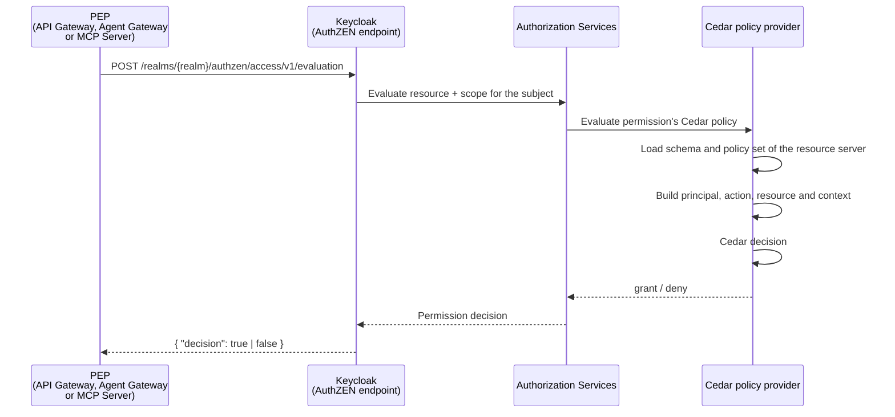

# Keycloak Cedar Authorization

A [Keycloak](https://www.keycloak.org/) extension that integrates [Cedar](https://www.cedarpolicy.com/) as a policy type in Keycloak Authorization Services, enabling Keycloak's [AuthZEN](https://openid.net/specs/authorization-api-1_0.html) endpoint to evaluate authorization requests for users and AI agents using Cedar policies.

For the background and design, see [Keycloak Cedar Policy Engine](https://twogenidentity.com/research/keycloak-cedar-policy-engine/), a research article by TwoGenIdentity.

## Overview

### Main Features

This extension enables Keycloak Authorization Services to act as a **Policy Decision Point (PDP) compatible with AuthZEN, powered by Cedar**. Cedar runs inside the Keycloak process through [cedar-java](https://github.com/cedar-policy/cedar-java); no external PDP is required.

- **Cedar policy type**: Adds the `cedar` policy type to Authorization Services; permissions reference Cedar policies like any other policy.
- **Schema per resource server**: Each resource server declares its own Cedar namespace (client attribute `cedar.schema`) on top of the `Keycloak` namespace, which the provider includes for users, clients, roles and groups.
- **Validation on write**: Every policy is strictly validated against the schema when it is created or updated; invalid policies are rejected by the Admin API with the Cedar errors.
- **One policy set per resource server**: All Cedar policies of a resource server are evaluated together, with Cedar semantics: a `forbid` in one policy overrides a `permit` in another.
- **Principal resolved by Keycloak**: Roles, groups, user attributes and `clientId` come from Keycloak's stores. Values sent in `subject.properties` are ignored.
- **Declared request context**: Facts known only to the PEP (`acr`, `amr`, `scope`, `aud`, calling agent) are passed in the AuthZEN `context`; only the keys declared in the schema reach Cedar, converted to their declared types.
- **AI agent identities**: Agents registered as clients, such as SPIFFE workloads, are Cedar principals of type `Keycloak::Client`.
- **Policies as code**: Schemas and policies are kept in Git, one folder per resource server, checked with the Cedar CLI and delivered through the Keycloak Admin REST API.
- **Fail closed**: Any error during evaluation (invalid schema, undeclared action or resource type, unknown subject) results in a deny.

### Compatibility

| Component | Version |
|-----------|---------|
| Keycloak | 26.7.0 |
| cedar-java | 4.10.0 |
| Java | 17 |

## Architecture

### Components Overview

```
┌──────────┐  AuthZEN request   ┌──────────────────────────────────────────────────────────┐
│          │ ─────────────────► │ Keycloak                                                 │
│   PEP    │                    │                                                          │
│          │ ◄───────────────── │   AuthZEN endpoint                                       │
└──────────┘  { decision }      │        │                                                 │
                                │        ▼                                                 │
                                │   Authorization Services ── permissions ──► Cedar policy │
                                │                                                 │        │
                                │                                                 ▼        │
                                │                                     Cedar engine (JNI)   │
                                └──────────────────────────────────────────────────────────┘
```

The PEP is any component that enforces the decision: an API gateway, an agent gateway in front of AI agents, or an MCP server that checks each tool call itself. Keycloak identifies the resource server as the client of the PEP's access token (its `azp`). This determines which Cedar schema and policy set Keycloak uses for evaluation. Keycloak resolves the AuthZEN request to a resource, a scope and a subject, and evaluates the matching permissions. For every Cedar policy involved, the provider builds a Cedar request from Keycloak's data and the resource server's schema.

### Sequence Diagram



### Mapping to Cedar

| AuthZEN | Keycloak | Cedar |
|---------|----------|-------|
| `subject` | User, or client for a service account user (see below) | `Keycloak::User::"<id>"` / `Keycloak::Client::"<id>"` |
| `action.name` | Authorization scope | `<Namespace>::Action::"<scope>"` |
| `resource.type`, `resource.id` | Resource type and name | `<Namespace>::<Type>::"<resource name>"` |
| `context` | Evaluation context | `context`, declared keys only |

**Principal attributes:**

| Cedar type | Attributes | Tags | Parents |
|------------|------------|------|---------|
| `Keycloak::User` | `username`, `email?`, `emailVerified`, `enabled`, `roles`, `groups` | User attributes listed in `user-attributes` | `Keycloak::Role`, `Keycloak::Group` |
| `Keycloak::Client` | `clientId`, `enabled`, `roles` | | `Keycloak::Role` |

- `roles` are the effective roles (direct, composite and inherited from groups). Realm roles are named `role`, client roles `clientId/role`.
- `groups` are group paths, including ancestors, so `principal in Keycloak::Group::"/engineering"` matches members of `/engineering/agents`.
- **Clients and AI agents**: Keycloak's AuthZEN endpoint accepts a subject of type `client` only when it is the caller itself (the `azp` of the PEP's token); for any other client it answers `false` without evaluating. To authorize an agent that authenticates with client credentials, send the `sub` of the agent's token as `{ "type": "user", "id": "<sub>" }`: it is the agent's service account user, which the provider maps to `Keycloak::Client` with the client's `clientId` and the service account's roles.

**Resource attributes:** the declared attributes of the entity type are filled from the Keycloak resource (`name`, `type`, `displayName`, `uris`, or the resource attribute of the same name). When the entity type declares `tags`, every resource attribute is also available as a tag.

## Configuration

### Resource Server Schema

Each resource server defines its own resource types, actions and context in a Cedar schema, stored in the client attribute `cedar.schema`, in the [Cedar schema format](https://docs.cedarpolicy.com/schema/human-readable-schema.html). Nothing about the protected domain is built in: `Documents` in this README and in the demo is only an example.

Only the principals are fixed. Users and clients are always `Keycloak::User` and `Keycloak::Client`, from the [`Keycloak` namespace](src/main/resources/cedar/keycloak.cedarschema) that the provider includes. This namespace is reserved.

| Schema element | Must match in Keycloak |
|----------------|------------------------|
| Namespace | Any name except `Keycloak`; exactly one per resource server |
| Entity type | Resource type, e.g. resources of type `Tool` are `Mcp::Tool` |
| Entity id | Resource name, e.g. `Mcp::Tool::"get_customer"` |
| Entity attributes | `name`, `type`, `displayName`, `uris` or a resource attribute of the same name; types `String`, `Long`, `Bool`, `Set<String>` |
| Entity `tags` | All resource attributes, as `Set<String>` |
| Action | Authorization scope, e.g. scope `call` is `Mcp::Action::"call"` |
| Action `context` | AuthZEN `context` keys accepted from the PEP |

A resource whose type or scope is not declared in the schema is denied.

**Example: documents** (used by the demo, [`tests/policies/documents-api/`](tests/policies/documents-api))

```cedar
namespace Documents {
  entity Document = { name: String, type: String } tags Set<String>;

  type RequestContext = {
    agent?: String,
    acr?: String,
    amr?: Set<String>,
    scope?: Set<String>,
    aud?: Set<String>,
  };

  action read, write appliesTo {
    principal: [Keycloak::User, Keycloak::Client],
    resource: [Document],
    context: RequestContext,
  };
}
```

**Example: MCP tools** (used by the demo, [`tests/policies/mcp-server/`](tests/policies/mcp-server)), for Keycloak resources of type `Tool`, one per tool and named after it (`get_customer` is `Mcp::Tool::"get_customer"`), and a scope `call`:

```cedar
namespace Mcp {
  entity Tool = { name: String } tags Set<String>;

  type RequestContext = { agent?: String, scope?: Set<String> };

  action call appliesTo {
    principal: [Keycloak::User, Keycloak::Client],
    resource: [Tool],
    context: RequestContext,
  };
}
```

Policies refer to tools by name: a single tool in the policy scope (`resource == Mcp::Tool::"delete_customer"`), several tools in the condition (`resource in [...]`). Cedar does not accept a list of tools in the policy scope.

```cedar
// Agents with the role support-agent may call the customer read tools, when their token grants mcp:tools.
@id("support-agents-call-customer-read-tools")
permit (
  principal is Keycloak::Client,
  action == Mcp::Action::"call",
  resource is Mcp::Tool
)
when
{
  resource in [Mcp::Tool::"get_customer", Mcp::Tool::"list_customers"] &&
  principal.roles.contains("support-agent") &&
  context has scope &&
  context.scope.contains("mcp:tools")
};

// No agent may call delete_customer, whatever other policies allow.
@id("no-agent-calls-delete-customer")
forbid (
  principal is Keycloak::Client,
  action == Mcp::Action::"call",
  resource == Mcp::Tool::"delete_customer"
);
```

To group tools without listing them, give the Keycloak resources an attribute, for example `category`, and test it as a tag: `resource.hasTag("category") && resource.getTag("category").contains("customer")`.

### Cedar Policy

A Cedar policy is created in the resource server's Authorization Services, with type `cedar`:

| Name | Type | Required | Description |
|------|------|----------|-------------|
| `name` | string | Yes | Keycloak policy name; decision logs refer to statements as `<name>#<@id>` |
| `code` | string | Yes | Cedar policy statements; templates are not supported |

```
POST /admin/realms/{realm}/clients/{client-uuid}/authz/resource-server/policy/cedar
{ "name": "documents", "code": "@id(\"document-readers-read\") permit (...);" }
```

### Provider Options

| Option | Default | Description |
|--------|---------|-------------|
| `--spi-policy--cedar--user-attributes` | (none) | User attributes, separated by commas, exposed as principal tags, e.g. `department,country` |
| `CEDAR_JAVA_FFI_LIB` (environment) | | Path to the cedar-java native library for the host platform |

## Installation

1. Build the provider: `mvn package`.
2. Copy `target/keycloak-cedar-authorization.jar` to `/opt/keycloak/providers/`.
3. Make the Linux native library available (extracted at build time to `target/native/jne/linux/<arch>/libcedar_java_ffi.so`) and set `CEDAR_JAVA_FFI_LIB` to its path.
4. Enable the AuthZEN feature: `--features=authzen`.

See [`tests/docker-compose.yml`](tests/docker-compose.yml) for a complete example.

## Policies as Code

Keep each resource server's schema and policies in a folder of their own. The demo policies follow this layout in [`tests/policies/`](tests/policies).

```
policies/
  <resource-server>/
    schema.cedarschema     # stored in the client attribute cedar.schema
    <name>.cedar           # one Keycloak Cedar policy, named <name>
```

| Item | Convention | Example |
|------|------------|---------|
| Folder | Resource server `clientId`, or a short alias when it is a URI | `policies/documents-api/` |
| Policy file | Lowercase words joined by hyphens, named after what it decides | `documents.cedar` |
| Keycloak policy name | File name without `.cedar` | `documents` |
| Statement id | `@id("...")`, lowercase words joined by hyphens, unique in the file | `@id("document-readers-read")` |

Policies are checked with the official Cedar CLI, in a container:

```sh
make policies-check                                   # tests/policies
tools/cedar-cli/check-policies.sh <policies-folder>   # any folder in this repository
```

## Running the Demo

### Prerequisites

- Java 17 and Maven
- Docker with Docker Compose
- `curl` and `jq`

### Start the Environment

```sh
make up
```

This builds the provider and starts [`tests/docker-compose.yml`](tests/docker-compose.yml): Keycloak with the provider on `http://localhost:8082`, then the `keycloak-bootstrap` container, which runs once to configure the `demo` realm with [`tests/keycloak/bootstrap.sh`](tests/keycloak/bootstrap.sh) and the policies in [`tests/policies/`](tests/policies). After `mvn package`, `docker compose -f tests/docker-compose.yml up` does the same. On Intel/AMD Docker hosts, run `CEDAR_ARCH=x86_64 make up` (the default is `aarch64`).

| Item | Value |
|------|-------|
| Admin Console | `http://localhost:8082/admin`, user `admin`, password `admin` |
| Realm | `demo` |
| Users | `alice` (role `document-reader`), `bob` (role `document-writer`); password = username |
| Resource server | `documents-api`, secret `documents-api-secret`; policies in [`tests/policies/documents-api/`](tests/policies/documents-api) |
| Resource | `document-1` of type `Document`, scopes `read` and `write`, on `documents-api` |
| AI agent (client) | `spiffe://example.org/ns/agents/sa/planner-agent`, secret `planner-agent-secret`, role `support-agent` |
| Resource server (MCP gateway) | `mcp-server`, secret `mcp-server-secret`; policies in [`tests/policies/mcp-server/`](tests/policies/mcp-server) |
| MCP tools | `get_customer`, `list_customers` and `delete_customer`, of type `Tool`, scope `call` |

> [!WARNING]
> These credentials are fixed demo values. Use them only in a local environment.

### Send an AuthZEN Request

The PEP authenticates as the resource server; Keycloak evaluates the request against that client's policies.

```sh
TOKEN=$(tests/cli-tests/get-at.sh documents-api documents-api-secret)

curl -s -X POST http://localhost:8082/realms/demo/authzen/access/v1/evaluation \
  -H "Authorization: Bearer $TOKEN" \
  -H "Content-Type: application/json" \
  -d '{
    "subject":  { "type": "user", "id": "alice" },
    "resource": { "type": "Document", "id": "document-1" },
    "action":   { "name": "read" }
  }'
```

```json
{ "decision": true }
```

### Stop the Environment

```sh
make logs    # follow the Keycloak logs, including Cedar decisions
make down    # stop Keycloak and delete its data
```

## Testing

```sh
make test            # unit tests
make policies-check  # Cedar CLI format check and strict validation of tests/policies/
make test-e2e-run    # AuthZEN checks against a running environment (make up)
make test-e2e        # make up, the AuthZEN checks, then make down
```

## Considerations

> [!CAUTION]
> **Experimental Version: This software is currently experimental and is provided AS IS without any warranties.**
>
> - Not recommended for production use
> - Issues and feedback should be reported via the GitHub issue tracker
> - Maintenance and response times are not guaranteed
>
> By using this experimental software, you acknowledge and accept these conditions.

- The AuthZEN endpoint accepts valid access tokens issued by the realm. Ensure that only authorized clients can obtain tokens for resource servers with Cedar policies, and keep their credentials only at the PEP.
- AuthZEN context values are trusted inputs from the PEP. The PEP is responsible for ensuring that these values are authentic and cannot be manipulated by the requesting user or agent.
- Keycloak passes AuthZEN context values as strings; the provider converts them to the declared types. Send `Set<String>` values as JSON arrays.

## Examples

<details>
<summary><strong>Example 1: Access by Role</strong></summary>

```cedar
@id("document-readers-read")
permit (
  principal in Keycloak::Role::"document-reader",
  action == Documents::Action::"read",
  resource is Documents::Document
);
```

**AuthZEN request:**

```json
{
  "subject":  { "type": "user", "id": "alice" },
  "resource": { "type": "Document", "id": "document-1" },
  "action":   { "name": "read" }
}
```

**Response:** `{ "decision": true }` when `alice` has the role `document-reader`.

</details>

<details>
<summary><strong>Example 2: AI Agent (SPIFFE Client)</strong></summary>

An AI agent registered as a client, identified by its SPIFFE ID, reads documents of the `documents-api` resource server ([`tests/policies/documents-api/planner-agent-read.cedar`](tests/policies/documents-api/planner-agent-read.cedar)):

```cedar
@id("planner-agent-read")
permit (
  principal is Keycloak::Client,
  action == Documents::Action::"read",
  resource is Documents::Document
)
when { principal.clientId == "spiffe://example.org/ns/agents/sa/planner-agent" };
```

**AuthZEN request**, sent by the PEP with the `documents-api` access token. The agent authenticates with client credentials, and the PEP sends the `sub` of the agent's token, which is the agent's service account user:

```json
{
  "subject":  { "type": "user", "id": "<sub of the agent's access token>" },
  "resource": { "type": "Document", "id": "document-1" },
  "action":   { "name": "read" }
}
```

</details>

<details>
<summary><strong>Example 3: Authentication Context from the PEP</strong></summary>

```cedar
@id("editors-write-with-passkey")
permit (
  principal in Keycloak::Role::"document-editor",
  action == Documents::Action::"write",
  resource is Documents::Document
)
when {
  context has acr && context.acr == "inherence" &&
  context has amr && context.amr.contains("passkeys")
};
```

**AuthZEN request:**

```json
{
  "subject":  { "type": "user", "id": "carol" },
  "resource": { "type": "Document", "id": "document-1" },
  "action":   { "name": "write" },
  "context":  { "acr": "inherence", "amr": ["passkeys", "mfa"] }
}
```

</details>

<details>
<summary><strong>Example 4: AI Agent Calling MCP Tools</strong></summary>

An MCP gateway acts as the PEP for the resource server `mcp-server`. Each MCP tool is a Keycloak resource of type `Tool`, named after the tool, with the scope `call`. The policies refer to the tools by name ([`tests/policies/mcp-server/tools.cedar`](tests/policies/mcp-server/tools.cedar)):

```cedar
@id("support-agents-call-customer-read-tools")
permit (
  principal is Keycloak::Client,
  action == Mcp::Action::"call",
  resource is Mcp::Tool
)
when
{
  resource in [Mcp::Tool::"get_customer", Mcp::Tool::"list_customers"] &&
  principal.roles.contains("support-agent") &&
  context has scope &&
  context.scope.contains("mcp:tools")
};

@id("tool-admins-call-all-tools")
permit (
  principal is Keycloak::Client,
  action == Mcp::Action::"call",
  resource is Mcp::Tool
)
when { principal.roles.contains("tool-admin") };

@id("no-agent-calls-delete-customer")
forbid (
  principal is Keycloak::Client,
  action == Mcp::Action::"call",
  resource == Mcp::Tool::"delete_customer"
);
```

**MCP request from the agent to the gateway:**

```json
{
  "jsonrpc": "2.0",
  "id": 3,
  "method": "tools/call",
  "params": { "name": "get_customer", "arguments": { "id": "cust-12345" } }
}
```

**AuthZEN request from the gateway to Keycloak**, with the gateway's own access token. The subject is the `sub` of the agent's token (its service account user):

```json
{
  "subject":  { "type": "user", "id": "<sub of the agent's access token>" },
  "resource": { "type": "Tool", "id": "get_customer" },
  "action":   { "name": "call" },
  "context":  { "scope": ["mcp:tools"] }
}
```

**Decisions:**

| Agent role | Tool | `scope` in context | Decision | Reason |
|------------|------|--------------------|----------|--------|
| `support-agent` | `get_customer`, `list_customers` | `["mcp:tools"]` | `true` | `support-agents-call-customer-read-tools` |
| `support-agent` | `get_customer` | missing | `false` | No permit matches |
| `support-agent` | `delete_customer` | `["mcp:tools"]` | `false` | Not in the list; also forbidden |
| `tool-admin` | `list_customers` | any | `true` | `tool-admins-call-all-tools` |
| `tool-admin` | `delete_customer` | any | `false` | `no-agent-calls-delete-customer` overrides the permit |

</details>

## References

- [Keycloak Cedar Policy Engine](https://twogenidentity.com/research/keycloak-cedar-policy-engine/) (TwoGenIdentity research)
- [Cedar Policy Language](https://docs.cedarpolicy.com/)
- [cedar-java](https://github.com/cedar-policy/cedar-java)
- [AuthZEN Authorization API](https://openid.net/specs/authorization-api-1_0.html)
- [OpenID Foundation AuthZEN Working Group](https://openid.net/wg/authzen/)
- [Keycloak Authorization Services](https://www.keycloak.org/docs/latest/authorization_services/)

## Commercial Support

For professional services, architecture consulting, implementation, and commercial support around Keycloak and Cedar authorization, visit [TwoGenIdentity](https://twogenidentity.com).

## License

Licensed under the [Apache License, Version 2.0](LICENSE).

Originally designed and implemented by [Martin Besozzi](https://github.com/embesozzi), as part of the [TwoGenIdentity](https://twogenidentity.com) research on authorization for AI agents.
